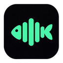

  

<h3 align="center">Fish Audio Voice Vault Online</h3>

  

**Fish Audio Voice Vault Online** es una biblioteca compartida para organizar voces de Fish Audio desde la web y una extensión de Chrome. Permite guardar enlaces, portadas y notas, administrar carpetas y favoritos, y mantener la colección sincronizada mediante Supabase.
